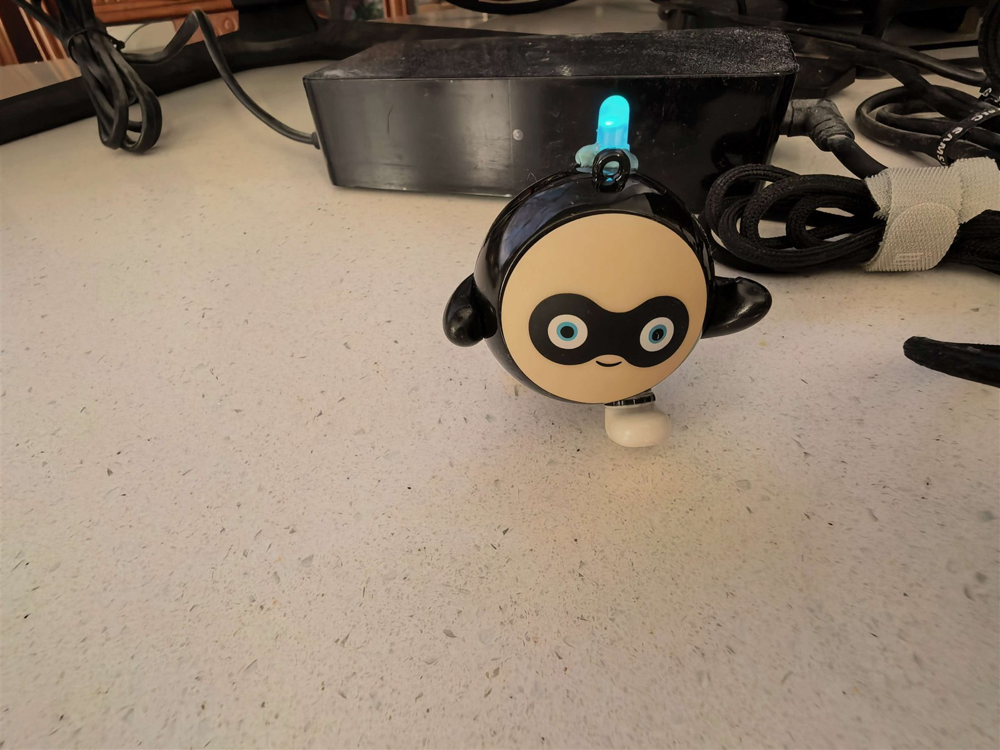
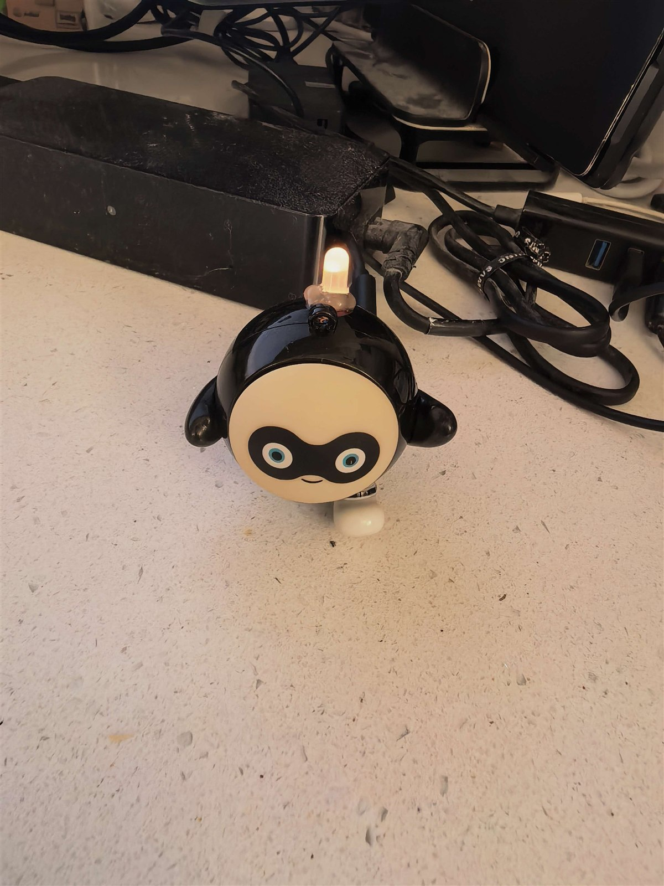
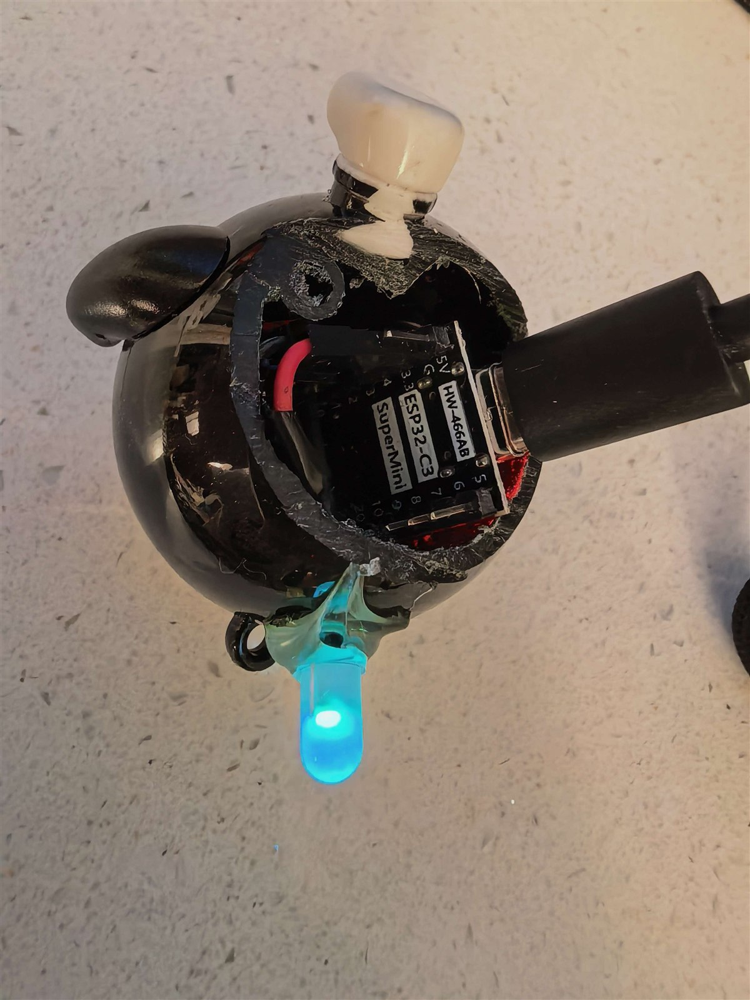
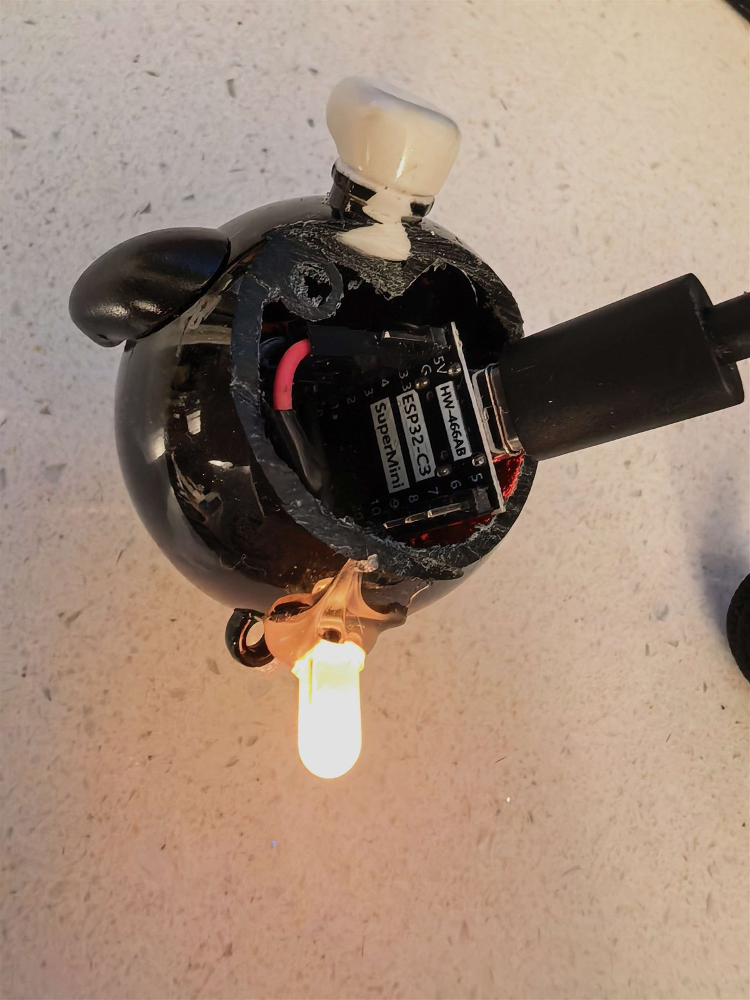

# DeepSeek Harness Sound & Light Alerts

### Approval, question, plan-choice, and completion cues · Chrome extension + ESP32 RGB light

**English** · **[简体中文](README.zh-CN.md)**

[](https://github.com/sl92983/deepseek-harness-sound-alerts/actions/workflows/validate.yml)
[](https://github.com/sl92983/deepseek-harness-sound-alerts/releases/latest)
[](manifest.json)
[](LICENSE)

## Hear the alert. See the light.

DeepSeek Harness can pause silently for an approval, an answer, or a plan choice while you are in another window. Finished turns can go unnoticed too. Repeatedly checking the tab breaks your flow.

**DeepSeek Harness Sound Alerts v1.3.3** turns those states into browser audio and an optional ESP32-powered RGB light. Place the light on an Eggy Party figure, and it becomes a small desktop companion that glows when your agent needs you.



**[Watch the demo video](https://github.com/sl92983/deepseek-harness-sound-alerts/blob/main/media/eggy-demo.mp4)**

## Core behavior

| DeepSeek Harness state | Audio cue | ESP32 light |
|---|---|---|
| Approval request | Five 880 Hz beeps | Repeating orange/cyan pulses |
| User question, plan choice, or plan review | Five 880 Hz beeps | Repeating orange/cyan pulses |
| Turn completed | Ascending five-note chime | Green breathing light, 5%–25% brightness |
| All pending items resolved, or page focused with none pending | None | Light turns off |
| History loaded without a live run | No false completion chime | No false completion effect |

- **Audio works alone**: ESP32 hardware is optional.
- **Persistent visual cues**: interaction lights stay active instead of flashing once and disappearing.
- **Duplicate suppression**: handles React re-renders, in-place key changes, and fast same-key replacements.
- **History protection**: completion requires evidence of a real running turn.
- **Ordered LAN commands**: light requests are serialized, and redundant clear requests are suppressed.

## Photos and video

| Hardware | Light effect |
|---|---|
|  |  |
|  |  |

The MP4 can be viewed on its GitHub file page: **[open the demo video](https://github.com/sl92983/deepseek-harness-sound-alerts/blob/main/media/eggy-demo.mp4)**.

## Install audio-only mode

1. Download `deepseek-harness-sound-alerts-v1.3.3.zip` from the **[latest release](https://github.com/sl92983/deepseek-harness-sound-alerts/releases/latest)** and extract it.
2. Open `chrome://extensions/`, enable **Developer mode**, and choose **Load unpacked**.
3. Select the extracted folder containing `manifest.json`.
4. Open or reload Harness at `http://127.0.0.1:3080`, then **click or press a key once** to unlock browser audio.

`localhost:3080` is supported too. A real user gesture is required after each full page reload.

## Add the ESP32 light

### Hardware

- ESP32-C3 SuperMini board;
- One WS2812B RGB LED;
- Wiring and a 3.3 V supply appropriate for the LED.

The wires in this build use unusual colors. **Verify the actual wire order and LED markings before powering it.**

| Wire in this build | Board / LED connection | Purpose |
|---|---|---|
| Black | `3V3` | VCC |
| Red | `GND` | Ground |
| Blue | `GPIO4` | DIN |
| Green | Not connected | DOUT |

### Configure and flash

1. Install Arduino IDE, ESP32 board support, and the **FastLED** library.
2. Open [`firmware/esp32-dsh-light/esp32-dsh-light.ino`](firmware/esp32-dsh-light/esp32-dsh-light.ino).
3. Copy `wifi_config.example.h` to `wifi_config.h` in the same directory and enter your own Wi-Fi name and password.
4. Select the ESP32-C3 board and flash the firmware. See the [firmware guide](firmware/esp32-dsh-light/README.md) for details.

`wifi_config.h` is ignored by Git and excluded from release packages. **Never put real network credentials in another public file.**

### Device discovery

The extension tries, in order:

1. `dsh-light.local`;
2. Common subnets listed in `FIXED_PREFIXES` in `content.js`;
3. The local subnet when WebRTC exposes a private local address.

For a separate wireless subnet, add the first three IPv4 octets to `FIXED_PREFIXES` and reload the extension. A device is accepted only when its root response starts with the exact identity line `dsh-light`.

The firmware exposes `GET /alert`, `GET /complete`, `GET /clear`, and `/` for status. These endpoints are unauthenticated; **use them only on a trusted LAN**.

## How it works

A `MutationObserver` watches documented state attributes on the local Harness page. Interaction states trigger five beeps and `/alert`. A confirmed live turn followed by its completion marker triggers the ascending chime and `/complete`. When all pending interactions disappear—or the page receives focus with none pending—the extension sends `/clear`.

The ESP32 drives one WS2812B through FastLED and receives state commands over LAN HTTP. Audio is synthesized in the browser and light effects run on the ESP32; neither requires a cloud service.

## Privacy and permissions

- The content script runs only on `127.0.0.1:3080` and `localhost:3080`.
- `permissions` is empty. There is no background service worker, storage, account, analytics, tracking, or remote code.
- Optional ESP32 support requires `http://*/*` host access for mDNS/subnet discovery and HTTP commands to devices identified as `dsh-light`.
- Conversation text, files, commands, and cookies are not collected or uploaded. Interaction keys remain in page memory for deduplication.
- Wi-Fi credentials belong only in the local ignored `wifi_config.h`; the extension never reads that file.

See [Privacy and Data Flow](docs/PRIVACY.md) and [SECURITY.md](SECURITY.md).

## Development and validation

Node.js is not required for normal installation. Contributors with Node.js 18 or newer can run:

```bash
npm run validate
npm run package
```

Checks cover JavaScript syntax, audio and light behavior, history suppression, manifest restrictions, documentation links, and secret patterns. The ZIP is written to `dist/` and contains the Chrome extension, ESP32 firmware source, and documentation. Private firmware configuration and demo media are excluded.

## Troubleshooting

- **No audio**: click or press a key after every full page reload; check tab and system volume.
- **No light found**: verify LAN connectivity, the firmware connection, and the exact `dsh-light` root response; configure `FIXED_PREFIXES` if needed.
- **Light stays on**: resolve every pending approval/question or focus the Harness page; if it still stays on, check device connectivity.
- **No completion cue**: confirm this was a live run rather than loaded history.
- **Manual audio diagnostics**: dispatch `dsh-approval-alert-test` or `dsh-completion-alert-test` from DevTools Console. These events are optional troubleshooting tools, not installation steps.

## License

[MIT](LICENSE) © 2026 sl92983

DeepSeek and DeepSeek Harness are names of their respective project. Eggy Party character rights belong to their respective owner; this project demonstrates a personal desktop hardware modification.
