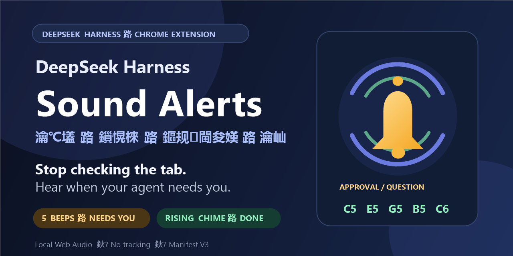

# DeepSeek Harness 声音提醒

### DeepSeek Harness Sound Alerts · 审批 / 提问 / 方案选择 / 完成提示音

**[English](README.md)** · **简体中文**

[](https://github.com/sl92983/deepseek-harness-sound-alerts/actions/workflows/validate.yml)
[](https://github.com/sl92983/deepseek-harness-sound-alerts/releases/latest)
[](manifest.json)
[](LICENSE)

## 不必反复查看页面，需要处理和已经完成时都有声音提醒

使用 AI 编程代理时，**审批请求、问题或方案选择**可能在你切到其他窗口、专注处理别的事情，甚至离开电脑后悄然出现。代理会一直停在那里等你；你却没有收到明显提示。即使本轮已经执行完成，也可能要等你再次打开页面才知道。

**DeepSeek Harness Sound Alerts（DeepSeek Harness 声音提醒）**把这些容易被错过的状态变成清晰、容易区分的声音：**需要审批、回答或选择时播放五声提示音，本轮完成时播放上行五音铃声**。你可以安心处理其他事情，不必为了查看状态反复切回页面。

> **English summary:** Clear local sound cues when DeepSeek Harness needs an approval, answer, or plan choice—and a different chime when the turn completes. [Read the full English documentation](README.md).

这是一款非官方、轻量级的 **DeepSeek Harness Web GUI Manifest V3 Chrome 扩展**。所有声音都通过 Web Audio 在浏览器本地合成，无需音频文件，无云服务、无分析统计、无远程网络请求。

*非官方社区项目，与 DeepSeek 无隶属关系，亦未获其背书。*



## 它能解决什么问题

- **需要你处理时及时提醒** — 出现审批请求、用户提问或计划评审面板时，播放五声短促的 **880 Hz** 提示音。
- **完成与等待使用不同声音** — 本轮完成后播放清晰的**上行五音铃声**（C5–E5–G5–B5–C6），不会与审批提醒混淆。
- **避免同一面板反复响** — 按交互 key 去重，React 重新渲染不会重复播放同一提醒。
- **减少历史记录误报** — 区分真实运行与加载历史轮次，旧记录不会误触发完成铃声。
- **保持轻量** — 无后台 Worker、不使用存储、无需构建，清单的 `permissions` 数组中没有任何权限条目。
- **数据留在本地** — 页面访问仅限 `127.0.0.1:3080` 和 `localhost:3080`，声音完全在浏览器中生成。

## 不同状态对应什么声音

| DeepSeek Harness 状态 | 声音 | 含义 |
|---|---|---|
| 等待审批 | 五声 880 Hz 提示音 | 代理等待你允许或拒绝 |
| 用户提问 / 计划评审 / 方案选择 | 五声 880 Hz 提示音 | 代理等待你回答或作出选择 |
| 本轮执行完成 | 上行五音铃声 | 当前运行已经结束 |
| 在没有活动运行时加载历史记录 | 不播放完成铃声 | 避免旧轮次造成误报 |

## 快速安装——下载 Release ZIP

### 1. 确认使用条件

- DeepSeek Harness Web GUI 已运行在 `http://127.0.0.1:3080` 或 `http://localhost:3080`。
- Chrome，或其他支持 Manifest V3 的 Chromium 浏览器。

### 2. 下载并解压

1. 打开 **[最新 Release](https://github.com/sl92983/deepseek-harness-sound-alerts/releases/latest)**。
2. 下载 `deepseek-harness-sound-alerts-v1.2.3.zip`。
3. **先解压 ZIP**，Chrome 不能直接加载 ZIP 文件。

### 3. 加载扩展

1. 在 Chrome 地址栏打开 `chrome://extensions/`（Edge 使用 `edge://extensions/`）。
2. 开启右上角的**开发者模式**。
3. 点击**加载已解压的扩展程序**。
4. 选择解压后包含 `manifest.json` 的文件夹。

### 4. 在 Harness 页面启用声音

1. 打开或刷新 DeepSeek Harness 页面。
2. **在页面内点击一次鼠标，或按一次键盘。** 浏览器要求必须先有真实用户操作，才允许 Web Audio 播放声音。
3. 确保页面标签没有静音，系统声音可以正常播放。

每次完整刷新页面后都需要重新点击或按键，因为新页面会创建新的音频上下文。

### 5. 测试两种提示音

完成上述用户操作后，在 Harness 页面打开开发者工具 Console，分别运行：

```js
document.dispatchEvent(new Event("dsh-approval-alert-test"));
document.dispatchEvent(new Event("dsh-completion-alert-test"));
```

第一条播放审批/提问提示音，第二条播放本轮完成铃声。

<details>
<summary><strong>另一种方式：从源码安装</strong></summary>

```bash
git clone https://github.com/sl92983/deepseek-harness-sound-alerts.git
```

然后在**加载已解压的扩展程序**中直接选择克隆下来的仓库根目录。根目录已经包含 `manifest.json`，无需安装依赖或构建。

</details>

## 工作原理

扩展通过 `MutationObserver` 只监听本地 DeepSeek Harness 页面：

- `[data-approval-key]` 对应审批请求。
- `[data-question-key]` 和 `[data-plan-review-key]` 对应用户提问与方案选择。
- 同一轮次先出现非尾部的 `[data-chat-turn]` 活动、再出现 `[data-turn-tail]` 时判定为完成；`[data-turn-process]` 作为附加兼容信号。

扩展只在页面内存中记录交互 key，并在对应元素消失后清理。完成铃声只对应已观察到真实运行控件的轮次，因此历史节点即使延迟加载，也不会仅因时间间隔而被误判为完成。所有声音均由 Web Audio API 即时合成，不需要下载任何音频素材。

## 自定义

修改 `content.js` 后，在 `chrome://extensions/` 中重新加载扩展，并刷新 Harness 页面：

| 想修改的内容 | 位置 |
|---|---|
| 审批/提问提示音次数 | `BEEP_COUNT`（默认 `5`） |
| 审批/提问提示音音高 | `playBeeps()` 中的 `freq`（默认 `880` Hz） |
| 完成铃声旋律 | `playCompletionSound()` 中的 `completionNote(...)` |

如果你的 Harness 使用其他端口，请同时修改 `manifest.json` 中的 `matches` 和 `host_permissions`。插件不会主动请求远程网站或任意站点访问权限。

## 故障排查

### 完全没有声音

- 每次完整刷新后，先在 Harness 页面内点击一次或按一次键盘。
- 检查页面标签是否静音、系统音量是否正常。
- 确认地址属于允许的本地地址，并包含端口 `3080`。
- 重新加载扩展，然后再刷新 Harness 页面。
- 打开开发者工具 Console，查看 `[DeepSeek Harness Sound Alerts]` 相关日志。

### 审批能响，但完成时不响

- 确认这是本次真实运行，而不是之前保存的历史会话。
- DeepSeek Harness 更新可能调整 DOM 属性。请对照 `content.js` 中的选择器检查当前页面，并在 Issue 中提供可复现的变更。

### 同一提醒意外重复播放

同一交互 key 在元素仍存在时应只播放一次。如果 Harness 更新导致元素不断重新挂载或生成新 key，请在 Issue 中说明 Harness 版本和复现步骤，不要附带私人会话内容。

## 隐私与权限

- `permissions` 为空数组。
- 主机访问仅限 `http://127.0.0.1:3080/*` 和 `http://localhost:3080/*`。
- 无后台 Service Worker、无存储、无 Cookie 读取、无分析统计、无跟踪、无远程代码。
- 无远程网络请求，声音在本地合成。
- 不传输会话内容；交互 key 仅用于内存去重。

安全报告请阅读 [SECURITY.md](SECURITY.md)，数据流说明请查看 [docs/PRIVACY.md](docs/PRIVACY.md)。

## 开发与验证

使用插件不需要 Node.js 或任何依赖。贡献者如需运行检查，请准备 Node.js 18 或更新版本：

```bash
npm run validate
```

该命令会执行 JavaScript 语法检查、两种提示音与去重/历史过滤行为测试、清单权限限制检查，以及敏感信息模式扫描。无需先运行 `npm install`。

在 Windows 上生成发布 ZIP：

```powershell
npm run package
```

压缩包输出到 `dist/`，只包含扩展运行文件、图标、说明文档和许可证。

## 参与贡献

欢迎提交兼容性修复、Bug 报告、翻译与文档改进。请先阅读 [CONTRIBUTING.md](CONTRIBUTING.md)，保持插件轻量，并确保 Issue 和提交中不包含凭据或私人会话内容。

如果这个项目帮你节省了时间，欢迎点一个 Star 或分享给其他 DeepSeek Harness 用户，让有需要的人更容易找到它。

## 许可证

[MIT](LICENSE) © 2026 sl92983

DeepSeek 与 DeepSeek Harness 的名称归其相应项目所有。本社区扩展与 DeepSeek 无隶属关系，亦未获其背书。
