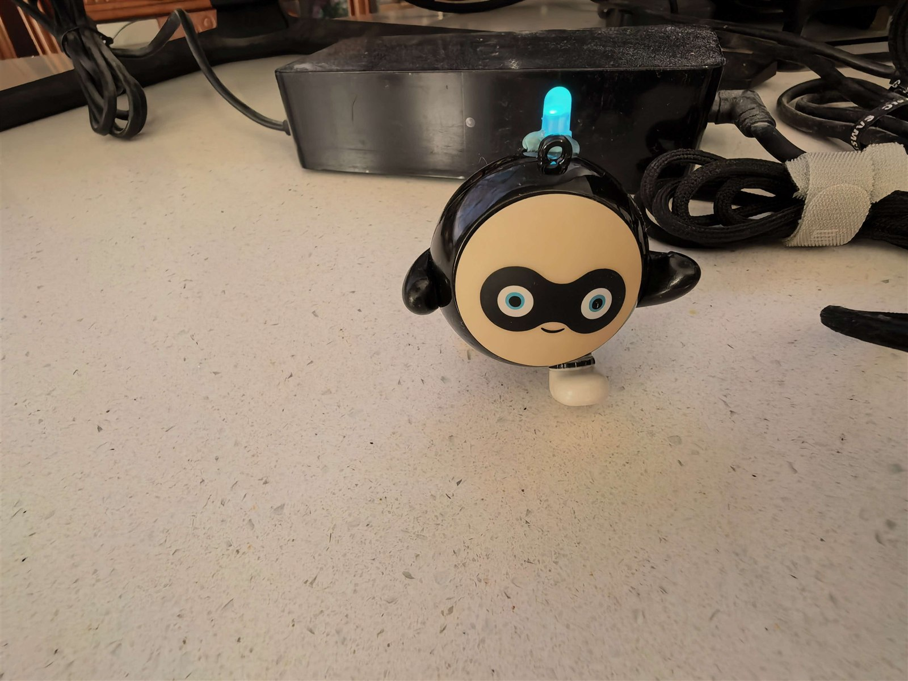
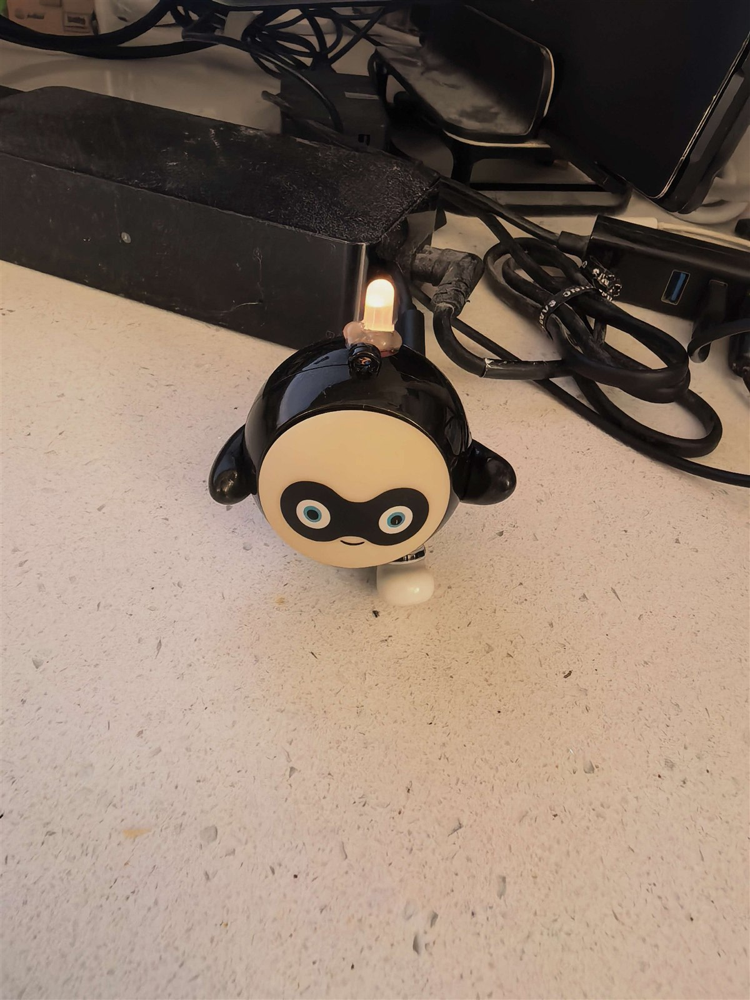
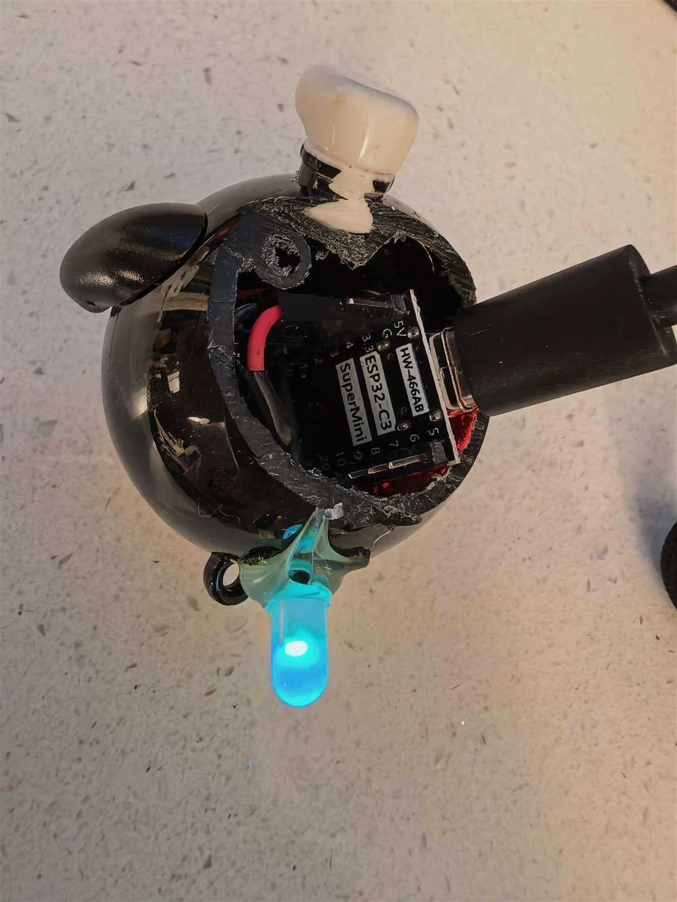
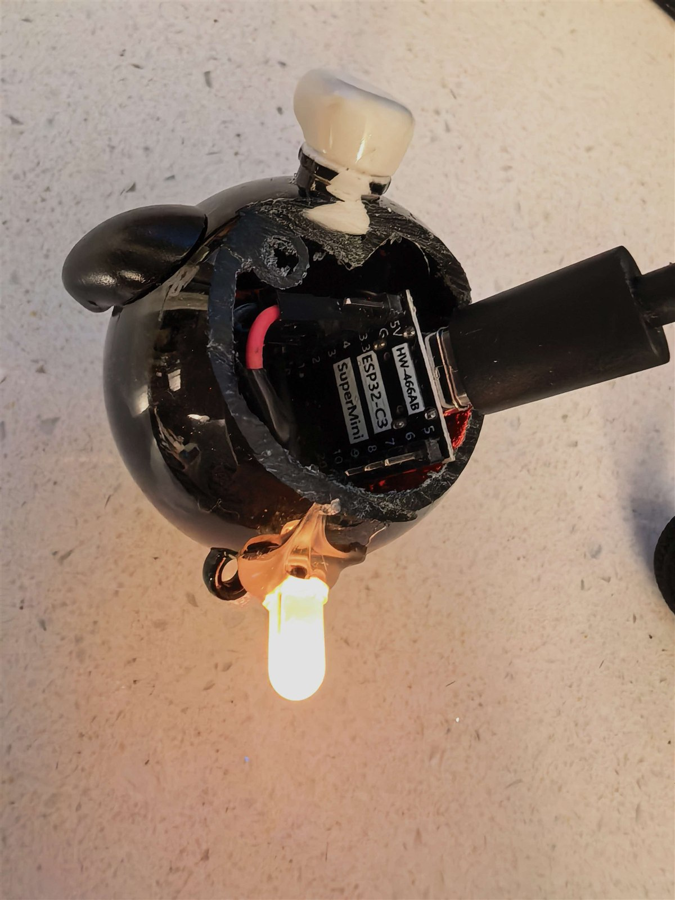

# DeepSeek Harness 声音与灯光提醒

### 审批 / 提问 / 方案选择 / 完成提醒 · Chrome 扩展 + ESP32 RGB 灯

**[English](README.md)** · **简体中文**

[](https://github.com/sl92983/deepseek-harness-sound-alerts/actions/workflows/validate.yml)
[](https://github.com/sl92983/deepseek-harness-sound-alerts/releases/latest)
[](manifest.json)
[](LICENSE)

## 需要你时，有声音，也有灯光

DeepSeek Harness 等待审批、回答问题或选择方案时，代理会停在原地；切换到其他窗口后，很容易错过。任务已经完成，也常常要切回页面才知道。

**DeepSeek Harness Sound Alerts v1.3.3** 将这些状态变成两种直观提醒：浏览器播放提示音，ESP32 同步驱动 RGB 灯。把灯放到蛋仔派对人偶上，就是一个会发光的桌面彩蛋。



**[观看演示视频](https://github.com/sl92983/deepseek-harness-sound-alerts/blob/main/media/eggy-demo.mp4)**

## 核心功能

| DeepSeek Harness 状态 | 声音提醒 | ESP32 灯光 |
|---|---|---|
| 等待审批 | 五声 880 Hz 提示音 | 橙色 / 青色交替脉冲，持续提醒 |
| 用户提问 / 方案选择 / 计划评审 | 五声 880 Hz 提示音 | 橙色 / 青色交替脉冲，持续提醒 |
| 本轮执行完成 | 上行五音铃声 | 绿色呼吸灯，亮度 5%–25% |
| 待处理项已解决，或切回页面且无待处理项 | 无 | 自动关灯 |
| 仅加载历史记录，没有活动运行 | 不误报完成铃声 | 不误触发完成灯效 |

- **声音可独立使用**：没有 ESP32 也能使用全部声音提醒。
- **灯光持续可见**：需要处理的灯效会保持，不只是一闪而过。
- **避免重复提醒**：按交互 key 去重，处理 React 重渲染、原地换 key 和同 key 节点替换。
- **避免历史误报**：只有确认真实运行的轮次才触发完成提醒。
- **局域网联动**：扩展发现灯后串行发送状态命令，避免请求乱序和重复关灯。

## 图片与视频

| 实物展示 | 灯光效果 |
|---|---|
|  |  |
|  |  |

视频为 MP4 格式，可在 GitHub 文件页观看：**[打开演示视频](https://github.com/sl92983/deepseek-harness-sound-alerts/blob/main/media/eggy-demo.mp4)**。

## 安装一：只使用声音提醒

1. 从 **[最新 Release](https://github.com/sl92983/deepseek-harness-sound-alerts/releases/latest)** 下载 `deepseek-harness-sound-alerts-v1.3.3.zip` 并解压。
2. 打开 `chrome://extensions/`，开启**开发者模式**，点击**加载已解压的扩展程序**。
3. 选择解压后包含 `manifest.json` 的文件夹。
4. 打开或刷新 `http://127.0.0.1:3080` 的 Harness 页面，**点击一次或按一次键盘**，允许浏览器播放声音。

如果实际地址使用 `localhost:3080`，扩展同样支持。每次整页刷新后都需要一次真实用户操作来解锁音频。

## 安装二：增加 ESP32 灯光联动

### 硬件

- ESP32-C3 SuperMini 开发板；
- 单颗 WS2812B RGB 灯珠；
- 与灯珠规格匹配的 3.3 V 供电和连接线。

本项目的实物线色与常规颜色不同，**接线前必须以线序和灯珠标识为准**：

| 实物线色 | 连接位置 | 用途 |
|---|---|---|
| 黑线 | `3V3` | VCC |
| 红线 | `GND` | 地线 |
| 蓝线 | `GPIO4` | DIN |
| 绿线 | 不接 | DOUT |

### 配网与烧录

1. 安装 Arduino IDE、ESP32 开发板支持和 **FastLED** 库。
2. 打开 [`firmware/esp32-dsh-light/esp32-dsh-light.ino`](firmware/esp32-dsh-light/esp32-dsh-light.ino)。
3. 将同目录的 `wifi_config.example.h` 复制为 `wifi_config.h`，填入你自己的 Wi-Fi 名称和密码。
4. 选择 ESP32-C3 开发板并烧录。详细配置见[固件说明](firmware/esp32-dsh-light/README.md)。

`wifi_config.h` 已加入 `.gitignore`，不会进入提交或发布包。**不要把真实 Wi-Fi 名称、密码写入其他公开文件。**

### 自动发现

扩展按以下顺序查找设备：

1. `dsh-light.local`；
2. `content.js` 中 `FIXED_PREFIXES` 配置的常见网段；
3. WebRTC 可获取本机内网地址时，追加本机网段。

如果 ESP32 位于独立网段，把它的 IPv4 前三段加入 `FIXED_PREFIXES`，然后重新加载扩展。设备根路径必须返回 `dsh-light`，扩展才会识别。

固件提供 `GET /alert`、`GET /complete`、`GET /clear` 和状态根路径 `/`。这些接口没有身份认证，**只应在可信局域网中使用**。

## 工作原理

扩展通过 `MutationObserver` 监听本地 Harness 页面的状态属性。审批、提问和方案选择触发五声提示音与 `/alert`；确认当前轮次真实运行并结束后，触发上行铃声与 `/complete`；所有待处理项消失，或用户回到页面且没有待处理项时，发送 `/clear`。

ESP32 使用 FastLED 驱动 WS2812B，并通过局域网 HTTP 接收三种状态命令。声音在浏览器本地合成，灯效在 ESP32 本地运行，不依赖云端服务。

## 隐私与权限

- 内容脚本只注入 `127.0.0.1:3080` 和 `localhost:3080`。
- `permissions` 为空；没有后台 Service Worker、存储、账号、分析统计或远程代码。
- 为发现和驱动可选的 ESP32，清单包含 `http://*/*` 主机访问；扩展会尝试 mDNS、网段探测，并向识别为 `dsh-light` 的设备发送 HTTP 命令。
- 不读取或上传会话正文、文件、命令或 Cookie；交互 key 仅保存在页面内存中用于去重。
- Wi-Fi 名称和密码只应存在于本地被忽略的 `wifi_config.h`，扩展不会读取该文件。

详见[隐私与数据流](docs/PRIVACY.md)和[安全政策](SECURITY.md)。

## 开发与验证

日常安装不需要 Node.js。贡献者使用 Node.js 18 或更高版本运行：

```bash
npm run validate
npm run package
```

检查包括 JavaScript 语法、声音与灯光行为、历史防误报、清单限制、文档链接和敏感信息扫描。ZIP 输出到 `dist/`，包含 Chrome 扩展、ESP32 固件源码及文档，不包含私有 Wi-Fi 配置或演示媒体。

## 故障排查

- **没有声音**：刷新页面后先点击一次或按一次键盘，并检查标签页和系统音量。
- **找不到灯**：确认电脑与 ESP32 位于可互通的局域网；检查固件是否连网、根路径是否返回 `dsh-light`，必要时配置 `FIXED_PREFIXES`。
- **灯一直亮**：处理完所有审批 / 提问，或切回 Harness 页面；仍无响应时检查设备网络。
- **完成提醒没有出现**：确认这是当前真实运行，而不是加载的历史会话。
- **需要单独测试声音**：可在开发者工具 Console 分派 `dsh-approval-alert-test` 或 `dsh-completion-alert-test` 事件；这只是排障手段，不是安装步骤。

## 许可证

[MIT](LICENSE) © 2026 sl92983

DeepSeek 与 DeepSeek Harness 的名称归其相应项目所有。蛋仔派对相关形象归其权利人所有，本项目仅展示个人桌面硬件改造效果。
